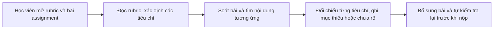
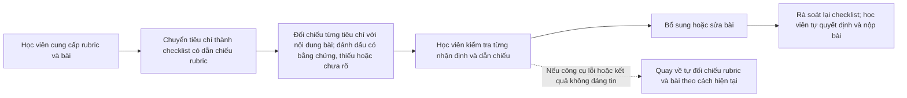

# Báo cáo nhóm — Day 02 Discovery & Problem Framing

> Bản chung của nhóm, viết trên repo do nhóm trưởng fork. Không copy file này sang repo cá nhân.
> Template chi tiết và prompt mẫu: [docs/01-worksheet.md](../../docs/01-worksheet.md). Bài mẫu: [docs/02-deliverable-example.md](../../docs/02-deliverable-example.md).

## 1. Thông tin nhóm

- Tên nhóm:
- Thành viên: xem `TEAM.md`
- Candidate problem được chọn (1 câu):
- Quyết định cuối: Go / Not Yet / No-Go

---

## 2. Hội tụ nhóm (CP3)

### 2.1. Pitch

| # | Người đưa ra | Candidate (Job Story ngắn) | Actor | Bottleneck | Câu hỏi phản biện nhận được (ai hỏi) |
|---:|---|---|---|---|---|
| 1 | | | | | |
| 2 | | | | | |
| 3 | | | | | |
| 4 | | | | | |
| 5 | | | | | |
| 6 | | | | | |
| 7 | | | | | |
| 8 | | | | | |
| 9 | | | | | |
| 10 | | | | | |
| 11 | | | | | |
| 12 | | | | | |

### 2.2. Cluster

| Cluster | Các candidate | Pattern chung |
|---|---|---|
| A | | |
| B | | |
| C | | |

### 2.3. Opportunity Solution Tree rút gọn

Gốc là **1 outcome**. Nhánh là **opportunity** (nhu cầu, pain), không phải tính năng hay công cụ.

```text
OUTCOME: 
├── Opportunity A: 
├── Opportunity B: 
└── Opportunity C: 
```

Những ý đã gạch bỏ vì là solution đội lốt opportunity:

-

### 2.4. Chấm điểm shortlist (1–5)

| Candidate | Actor rõ | Quy trình rõ | Pain có bằng chứng | Impact đo được | Vừa sức lab | So sánh được No AI/Rule/Workflow/Agent | Nhóm hiểu domain | Tổng |
|---|---:|---:|---:|---:|---:|---:|---:|---:|
| | | | | | | | | |
| | | | | | | | | |
| | | | | | | | | |

**Candidate được chọn:**

**Vì sao chọn:**

**Vì sao loại các candidate còn lại:**

**Xử lý bất đồng (nếu có):**

---

## 3. Kiểm chứng + research giải pháp đã có (CP4)

### 3.1. Assumption Map

| # | Giả định | Loại (Value / Usability / Feasibility / Viability) | Quan trọng (1–5) | Đã có bằng chứng (1–5) | Kiểm chứng trước? |
|---:|---|---|---:|---:|---|
| 1 | | | | | |
| 2 | | | | | |
| 3 | | | | | |
| 4 | | | | | |
| 5 | | | | | |
| 6 | | | | | |

*Điền 4–6 giả định; xóa dòng thừa.*

Giả định nhóm kiểm chứng trong buổi này:

### 3.2. Kiểm chứng

Cách đã dùng: Phỏng vấn / Survey / Log, ticket, review

Interview snapshot (mỗi buổi phỏng vấn một bảng, hoặc đặt file trong `report/assets/cp4-interview-snapshot-N.md`):

| Trường | Nội dung |
|---|---|
| Người được hỏi (vai trò, không ghi tên thật) | |
| Câu nói đáng nhớ nhất (nguyên văn) | |
| Lần gần nhất gặp vấn đề này: chuyện gì đã xảy ra? | |
| Hiện đang xử lý bằng cách nào (workaround)? | |
| Mất bao lâu, bao lần? | |
| Insight / opportunity rút ra | |

Tổng hợp:

| Nguồn | Số người / số mẫu | Tín hiệu xác nhận | Tín hiệu phản bác |
|---|---:|---|---|
| | | | |

**Nhóm đã sửa problem thế nào sau kiểm chứng:**

### 3.3. Research giải pháp đã có

| Công cụ / case / pattern | Link | Giải bước nào trong quy trình? | Điểm mạnh | Khoảng trống / rủi ro | Bài học cho nhóm |
|---|---|---|---|---|---|
| | | | | | |
| | | | | | |
| | | | | | |

---

## 4. Quy trình trước/sau (CP5)

### 4.1. Quy trình hiện tại

**Bản nháp theo mô tả candidate của Trọng; cần đối chiếu với người học khác ở CP4.** Thời gian 15–20 phút/lần hiện là tín hiệu sơ bộ do một thành viên cung cấp, chưa phải baseline đã kiểm chứng.



| Bước | Actor | Input | Output | Thời gian / tần suất | Ghi chú |
|---:|---|---|---|---|---|
| 1 | Học viên | Rubric, bài assignment | Hai tài liệu sẵn sàng để rà soát | Chưa đo | Candidate mô tả việc tự kiểm tra trước hạn nộp |
| 2 | Học viên | Rubric | Danh sách tiêu chí cần đáp ứng | Chưa tách riêng | Cần xác minh học viên có phải tự diễn giải/ghi lại tiêu chí không |
| 3 | Học viên | Bài assignment | Nội dung bài theo từng phần | Chưa tách riêng | Tìm nội dung tương ứng với từng tiêu chí |
| 4 | Học viên | Tiêu chí và bài assignment | Nhận định tiêu chí đạt, thiếu hoặc chưa rõ | Chưa đo riêng; toàn bộ đối chiếu thủ công khoảng 15–20 phút/lần (thông tin sơ bộ, chờ CP4 xác nhận) | Có nguy cơ bỏ sót tiêu chí nhỏ theo mô tả candidate |
| 5 | Học viên | Danh sách mục cần bổ sung | Bài đã sửa và được tự rà soát | Chưa đo | Học viên vẫn chịu trách nhiệm quyết định bài đã sẵn sàng để nộp |

**Bottleneck chính (giả thuyết cần CP4 xác minh):** bước 4 — đối chiếu từng tiêu chí với nội dung bài; chưa có bằng chứng cho biết đây là nút thắt lớn nhất hay tần suất bỏ sót thực tế.

### 4.2. Quy trình tương lai

**Phương án để nhóm đánh giá, chưa phải quyết định chọn AI.** Bước tổ chức tiêu chí có thể dùng checklist/Rule; nếu CP6 thấy cần, chỉ dùng AI để gợi ý vị trí bằng chứng hoặc tiêu chí có thể chưa được đáp ứng. Nhóm sẽ chốt mức can thiệp sau CP4.



**Phân vai và boundary dự kiến:** học viên cung cấp tài liệu, kiểm tra mọi nhận định và tự sửa/nộp bài. Checklist/Rule hoặc AI chỉ hỗ trợ đối chiếu; không tự chấm điểm, tự sửa nội dung, kết luận bài chắc chắn đạt, hoặc tự nộp bài. Mọi tiêu chí mơ hồ, thiếu căn cứ hay không tìm được bằng chứng phải được đánh dấu “cần người kiểm tra”, không được tự suy diễn. Nếu công cụ lỗi hoặc đưa kết quả không có căn cứ, quay lại cách tự đối chiếu hiện tại.

### 4.3. Before / after

| Chỉ số | Trước | Sau (kỳ vọng) | Ghi chú |
|---|---:|---:|---|
| Số bước | 5 bước trong bản đồ nháp | 6 bước trong phương án nháp | Đếm theo sơ đồ; cần xác nhận quy trình thực tế ở CP4 |
| Tổng thời gian | Khoảng 15–20 phút/lần đối chiếu thủ công (sơ bộ) | Chưa đo | Không đặt mục tiêu giảm thời gian trước khi có baseline và thử nghiệm |
| Số bước thủ công | 5 bước do học viên thực hiện | Ít nhất 4 bước của học viên: cung cấp tài liệu, kiểm tra kết quả, sửa bài, rà soát và quyết định nộp; các bước hỗ trợ chưa chốt Rule/AI | Phân loại tạm theo phương án tương lai, sẽ cập nhật sau CP6 |
| Bottleneck chính | Đối chiếu từng tiêu chí với bài; giả thuyết | Chưa xác định | Cần đo thời gian và hỏi về trường hợp bỏ sót |
| Rủi ro mới phát sinh | Bỏ sót tiêu chí khi tự rà; cần xác minh tần suất | Đánh dấu sai hoặc thiếu bằng chứng; người học quá tin kết quả; lộ nội dung bài nếu dùng công cụ không phù hợp | Giảm thiểu bằng dẫn chiếu rubric/bài, bước người học xác nhận, và quay về rà soát thủ công |

---

## 5. Problem Statement v0 (CP5)

| Trường | Nội dung |
|---|---|
| **Actor** | |
| **Quy trình** | |
| **Bottleneck** | |
| **Impact** | |
| **Success Metric** (baseline → target, cách đo) | |
| **Boundary** (AI không được làm gì; khi nào cần con người kiểm tra — HITL) | |

Phản biện nhận được (từ AI hoặc nhóm khác) và nhóm có đồng ý không:

-

---

## 6. Mức can thiệp AI (CP6)

### 6.1. Ma trận độ mơ hồ × độ phức tạp

Bài của nhóm nằm ở ô:

Vì sao:

### 6.2. So sánh 4 mức

| Mức | Phương án cho bài của nhóm | Đủ khi nào | Rủi ro | Chọn? |
|---|---|---|---|---|
| **No AI** (sửa quy trình) | | | | |
| **Rule** | | | | |
| **Workflow** | | | | |
| **Agent** | | | | |

**Mức chọn:**

**Vì sao không chọn mức đơn giản hơn:**

### 6.3. AI Canvas rút gọn

| Thành phần | Nội dung |
|---|---|
| **Prediction** — AI dự đoán / tạo ra gì? | |
| **Judgment** — con người cân nhắc, quyết định gì? | |
| **Action** — hành động cuối cùng là gì, ai làm? | |
| **Outcome** — đo kết quả bằng gì? | |
| **Input** — AI cần dữ liệu đầu vào gì mỗi lần chạy? Có sẵn không? | |
| **Feedback** — lấy phản hồi ở đâu để cải thiện? | |

### 6.4. Hai câu hỏi của Google PAIR

- Người dùng muốn **được hỗ trợ (augment)** hay **giao hẳn việc (automate)**? Bằng chứng:
- AI sai kiểu nào tệ hơn, **báo nhầm** hay **bỏ sót**? Vì sao, và thiết kế đã xử lý thế nào:

---

## 7. Problem Statement v1 + tiêu chí đánh giá (CP6)

| Trường | Nội dung |
|---|---|
| **Actor** | |
| **Quy trình** | |
| **Bottleneck** | |
| **Impact** | |
| **Success Metric** (baseline → target, cách đo) | |
| **Boundary** | |
| **AI intervention point** | |
| **Mức chọn** | No AI / Rule / Workflow / Agent |
| **Rủi ro & người kiểm tra** | |

**Thay đổi so với v0 và lý do:**

| Trường | v0 | v1 | Vì sao đổi |
|---|---|---|---|
| | | | |

**Tiêu chí đánh giá đầu ra của AI (3–5 tiêu chí):**

| # | Tiêu chí | Đạt khi | Không đạt khi |
|---:|---|---|---|
| 1 | Đối chiếu đúng rubric | Mọi trạng thái đạt/thiếu/chưa rõ bám vào đúng tiêu chí và phiên bản rubric được cung cấp | Bỏ qua, gộp nhầm hoặc tự thêm tiêu chí không có trong rubric |
| 2 | Bằng chứng có thể kiểm tra | Mỗi nhận định chỉ rõ đoạn/tiêu đề trong bài làm căn cứ để học viên kiểm tra lại | Kết luận đạt/thiếu nhưng không trỏ được đến bằng chứng trong bài |
| 3 | Không bịa hoặc suy diễn | Khi rubric hay bài không đủ thông tin, ghi “chưa rõ/cần người kiểm tra” | Tự suy ra nội dung, tiêu chí hoặc kết luận chắc chắn khi thiếu căn cứ |
| 4 | Phát hiện tiêu chí chưa đáp ứng | Nêu đúng các tiêu chí thiếu bằng chứng hoặc có dấu hiệu chưa đáp ứng trong bộ test được người chấm xác nhận | Bỏ sót tiêu chí chưa đáp ứng đã được xác định trong đáp án chuẩn |
| 5 | Giữ quyền quyết định của học viên | Đầu ra chỉ là gợi ý rà soát; học viên phải xác nhận và tự quyết định sửa/nộp | Tự sửa bài, tự cho điểm/kết luận đạt, hoặc tự nộp thay học viên |

**Bộ test case nháp (chưa chạy; cần rubric và bài mẫu/đáp án chuẩn được phép sử dụng để điền dữ liệu cụ thể):**

| # | Trường hợp kiểm thử | Kết quả mong đợi |
|---:|---|---|
| 1 | Tiêu chí được đáp ứng rõ ràng và có đoạn bằng chứng trực tiếp trong bài | Đánh dấu có bằng chứng, trỏ đúng tiêu chí rubric và vị trí bằng chứng; không khẳng định điểm số |
| 2 | Một tiêu chí không có nội dung tương ứng trong bài | Nêu tiêu chí còn thiếu, dẫn chiếu rubric; không tự tạo nội dung bổ sung |
| 3 | Bài có nội dung liên quan nhưng không đủ thông tin để kết luận đáp ứng tiêu chí | Đánh dấu “chưa rõ/cần người kiểm tra” và chỉ ra thông tin nào chưa đủ |
| 4 | Rubric có tiêu chí mơ hồ, mâu thuẫn hoặc không có trong tài liệu đầu vào | Không tự diễn giải thành quy tắc chắc chắn; yêu cầu người học/giảng viên làm rõ |
| 5 | Nội dung bài có định dạng khác thường hoặc phần văn bản không đọc được | Báo không thể kiểm tra phần đó và yêu cầu rà soát thủ công; không báo bài đã đạt |

**Cách đánh giá khi có bộ dữ liệu:** người chấm tạo đáp án chuẩn bằng rubric và bài mẫu, sau đó kiểm tra từng test theo 5 tiêu chí trên; ghi kết quả và lỗi thực tế trước khi đề xuất pilot. Hiện chưa có kết quả chạy test hay ngưỡng đạt, nên không kết luận hiệu năng.

---

## 8. Quyết định (CP6)

### 8.1. Bốn rủi ro

| Rủi ro | Câu hỏi | Mức độ rủi ro (Thấp = an toàn / TB / Cao = nguy hiểm) | Lý do / bằng chứng |
|---|---|---|---|
| **Value** | Người dùng có thật sự cần và sẽ dùng không? | | |
| **Usability** | Người dùng có dùng được, có hiểu và sửa được đầu ra của AI không? | | |
| **Feasibility** | Có đủ dữ liệu, công cụ, kỹ năng để làm không? | | |
| **Viability** | Có hợp chi phí, pháp lý, quy định tổ chức không? Ai vận hành? | | |

### 8.2. Kết luận

**Quyết định:** Go / Not Yet / No-Go

**Lý do:**

**Nếu Go — pilot nhỏ nhất:**

**Nếu Not Yet — cần kiểm chứng gì trước:**

**Nếu No-Go — nên làm gì thay AI:**

**Ngưỡng dừng** (nếu sau … mà … thì quay về …):

---

## 9. Hạn chế và hướng tiếp theo

-

## 10. Tài liệu tham khảo

-
