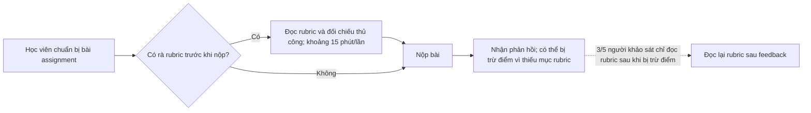
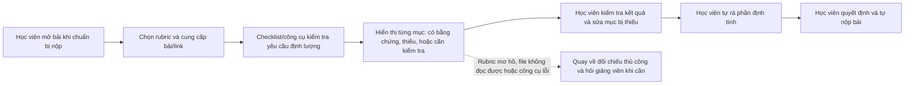

# Báo cáo nhóm — Day 02 Discovery & Problem Framing

> Bản chung của nhóm, viết trên repo do nhóm trưởng fork. Không copy file này sang repo cá nhân.
> Template chi tiết và prompt mẫu: [docs/01-worksheet.md](../../docs/01-worksheet.md). Bài mẫu: [docs/02-deliverable-example.md](../../docs/02-deliverable-example.md).

## 1. Thông tin nhóm

- Tên nhóm:
- Thành viên: xem `TEAM.md`
- Candidate problem được chọn (1 câu):
- Quyết định cuối: Go / Not Yet / No-Go

---

## 2. Hội tụ nhóm (CP3)

### 2.1. Pitch

| # | Người đưa ra | Candidate (Job Story ngắn) | Actor | Bottleneck | Câu hỏi phản biện nhận được (ai hỏi) |
|---:|---|---|---|---|---|
| 1 | | | | | |
| 2 | | | | | |
| 3 | | | | | |
| 4 | | | | | |
| 5 | | | | | |
| 6 | | | | | |
| 7 | | | | | |
| 8 | | | | | |
| 9 | | | | | |
| 10 | | | | | |
| 11 | | | | | |
| 12 | | | | | |

### 2.2. Cluster

| Cluster | Các candidate | Pattern chung |
|---|---|---|
| A | | |
| B | | |
| C | | |

### 2.3. Opportunity Solution Tree rút gọn

Gốc là **1 outcome**. Nhánh là **opportunity** (nhu cầu, pain), không phải tính năng hay công cụ.

```text
OUTCOME: 
├── Opportunity A: 
├── Opportunity B: 
└── Opportunity C: 
```

Những ý đã gạch bỏ vì là solution đội lốt opportunity:

-

### 2.4. Chấm điểm shortlist (1–5)

| Candidate | Actor rõ | Quy trình rõ | Pain có bằng chứng | Impact đo được | Vừa sức lab | So sánh được No AI/Rule/Workflow/Agent | Nhóm hiểu domain | Tổng |
|---|---:|---:|---:|---:|---:|---:|---:|---:|
| | | | | | | | | |
| | | | | | | | | |
| | | | | | | | | |

**Candidate được chọn:**

**Vì sao chọn:**

**Vì sao loại các candidate còn lại:**

**Xử lý bất đồng (nếu có):**

---

## 3. Kiểm chứng + research giải pháp đã có (CP4)

### 3.1. Assumption Map

| # | Giả định | Loại (Value / Usability / Feasibility / Viability) | Quan trọng (1–5) | Đã có bằng chứng (1–5) | Kiểm chứng trước? |
|---:|---|---|---:|---:|---|
| 1 | | | | | |
| 2 | | | | | |
| 3 | | | | | |
| 4 | | | | | |
| 5 | | | | | |
| 6 | | | | | |

*Điền 4–6 giả định; xóa dòng thừa.*

Giả định nhóm kiểm chứng trong buổi này:

### 3.2. Kiểm chứng

Cách đã dùng: Phỏng vấn / Survey / Log, ticket, review

Interview snapshot (mỗi buổi phỏng vấn một bảng, hoặc đặt file trong `report/assets/cp4-interview-snapshot-N.md`):

| Trường | Nội dung |
|---|---|
| Người được hỏi (vai trò, không ghi tên thật) | |
| Câu nói đáng nhớ nhất (nguyên văn) | |
| Lần gần nhất gặp vấn đề này: chuyện gì đã xảy ra? | |
| Hiện đang xử lý bằng cách nào (workaround)? | |
| Mất bao lâu, bao lần? | |
| Insight / opportunity rút ra | |

Tổng hợp:

| Nguồn | Số người / số mẫu | Tín hiệu xác nhận | Tín hiệu phản bác |
|---|---:|---|---|
| | | | |

**Nhóm đã sửa problem thế nào sau kiểm chứng:**

### 3.3. Research giải pháp đã có

| Công cụ / case / pattern | Link | Giải bước nào trong quy trình? | Điểm mạnh | Khoảng trống / rủi ro | Bài học cho nhóm |
|---|---|---|---|---|---|
| | | | | | |
| | | | | | |
| | | | | | |

---

## 4. Quy trình trước/sau (CP5)

### 4.1. Quy trình hiện tại

**Cập nhật theo CP4:** survey Google Form 5 người ghi nhận 5/5 từng bị trừ điểm vì thiếu mục rubric; thời gian đối chiếu thủ công khoảng 15 phút/lần. Đây là số liệu tự báo cáo từ mẫu nhỏ, cần ghi rõ hạn chế khi kết luận. 3/5 cho biết chỉ đọc rubric sau khi bị trừ điểm.



| Bước | Actor | Input | Output | Thời gian / tần suất | Ghi chú |
|---:|---|---|---|---|---|
| 1 | Học viên | Assignment đang làm | Bản bài chuẩn bị để nộp | Chưa đo | Tần suất và thời điểm bắt đầu đọc rubric cần kiểm chứng thêm |
| 2 | Học viên | Rubric và bài assignment | Hiểu các tiêu chí cần đáp ứng | 3/5 người khảo sát cho biết chỉ đọc rubric sau khi bị trừ điểm | Tín hiệu cho thấy việc chủ động rà rubric trước khi nộp là vấn đề về thói quen/điểm chạm |
| 3 | Học viên | Rubric và bài assignment | Tự nhận định các yêu cầu đã đáp ứng hay còn thiếu | Khoảng 15 phút/lần đối chiếu theo survey; số tự báo cáo, mẫu nhỏ | Nhóm thu hẹp phạm vi có thể tự động kiểm tra sang các tiêu chí định lượng |
| 4 | Học viên | Bài đã rà soát | Bài được nộp | Chưa đo | Chưa có dữ liệu chi tiết về thao tác nộp |
| 5 | Học viên | Kết quả chấm/feedback | Biết tiêu chí hoặc mục nào bị thiếu | 5/5 người được khảo sát từng bị trừ điểm vì thiếu mục rubric | Tín hiệu từ survey; chưa có snapshot/lịch sử chấm để đối chiếu độc lập |

**Bottleneck cần kiểm tra:** người học có thể không rà rubric trước khi nộp (3/5 chỉ đọc sau khi bị trừ điểm); khi rà thủ công, việc đối chiếu mất khoảng 15 phút/lần theo survey. Chưa đủ dữ liệu để kết luận bước nào gây ra phần lớn lỗi thiếu mục.

### 4.2. Quy trình tương lai

**Phương án theo kết quả CP4, mức can thiệp để CP6 chốt:** chỉ kiểm tra các tiêu chí định lượng, kiểm chứng được như mục/section bắt buộc có hay không, link repo có được cung cấp hay không, và tên/định dạng file theo yêu cầu. Phần định tính (chất lượng lập luận, phân tích sâu) không tự động kết luận đạt; người học tự rà. Checklist hoặc công cụ cần đưa kết quả nhanh và không đòi hỏi người học thay đổi nhiều thói quen.



**Phân vai và boundary:** công cụ chỉ báo trạng thái hiện diện/thiếu của yêu cầu định lượng và vị trí bằng chứng; không chấm chất lượng nội dung, không tự sửa bài, không tuyên bố bài chắc chắn đạt rubric và không tự nộp bài. Học viên tự rà phần định tính và quyết định cuối. Nếu rubric mơ hồ, file không đọc được hoặc kết quả thiếu căn cứ, chuyển sang kiểm tra thủ công.

### 4.3. Before / after

| Chỉ số | Trước | Sau (kỳ vọng) | Ghi chú |
|---|---:|---:|---|
| Số bước | 5 bước theo sơ đồ khái quát | 7 bước theo phương án dự kiến | Đếm theo sơ đồ; cần xác nhận trong pilot |
| Tổng thời gian | Khoảng 15 phút/lần đối chiếu theo survey (tự báo cáo, 5 người) | Mục tiêu thử nghiệm: dưới 3 phút cho bước kiểm tra; chưa đo | <3 phút là ngưỡng giá trị giả định trong Assumption Map, chưa phải kết quả đạt |
| Thời gian có kết quả kiểm tra | Chưa tách riêng | Mục tiêu UX: dưới 30 giây | Yêu cầu thiết kế đề xuất sau survey, cần đo khi thử |
| Số bước thủ công | 5 bước trong quy trình khái quát; mức tự động hóa hiện tại chưa được tách đo | Ít nhất 4 bước do học viên làm: cung cấp bài, kiểm tra kết quả, sửa bài, rà phần định tính và quyết định nộp | Phân loại theo phương án, mức can thiệp chờ CP6 |
| Bottleneck chính | Không chủ động đọc/rà rubric trước khi nộp; 3/5 đọc sau khi bị trừ điểm; đối chiếu thủ công khoảng 15 phút | Chưa đo | Cần thử xem điểm chạm mới có giúp học viên kiểm tra trước deadline không |
| Rủi ro mới phát sinh | Bỏ sót mục rubric khi tự rà (5/5 từng bị trừ điểm theo survey) | Báo thiếu sai, bỏ sót mục thiếu, hoặc người học hiểu nhầm kiểm tra định lượng là bảo đảm đạt toàn bộ rubric | Chỉ kiểm tra mục khách quan, hiển thị bằng chứng/trạng thái, nhắc phần định tính vẫn cần người học rà |

---

## 5. Problem Statement v0 (CP5)

| Trường | Nội dung |
|---|---|
| **Actor** | |
| **Quy trình** | |
| **Bottleneck** | |
| **Impact** | |
| **Success Metric** (baseline → target, cách đo) | |
| **Boundary** (AI không được làm gì; khi nào cần con người kiểm tra — HITL) | |

Phản biện nhận được (từ AI hoặc nhóm khác) và nhóm có đồng ý không:

-

---

## 6. Mức can thiệp AI (CP6)

### 6.1. Ma trận độ mơ hồ × độ phức tạp

Bài của nhóm nằm ở ô:

Vì sao:

### 6.2. So sánh 4 mức

| Mức | Phương án cho bài của nhóm | Đủ khi nào | Rủi ro | Chọn? |
|---|---|---|---|---|
| **No AI** (sửa quy trình) | | | | |
| **Rule** | | | | |
| **Workflow** | | | | |
| **Agent** | | | | |

**Mức chọn:**

**Vì sao không chọn mức đơn giản hơn:**

### 6.3. AI Canvas rút gọn

| Thành phần | Nội dung |
|---|---|
| **Prediction** — AI dự đoán / tạo ra gì? | |
| **Judgment** — con người cân nhắc, quyết định gì? | |
| **Action** — hành động cuối cùng là gì, ai làm? | |
| **Outcome** — đo kết quả bằng gì? | |
| **Input** — AI cần dữ liệu đầu vào gì mỗi lần chạy? Có sẵn không? | |
| **Feedback** — lấy phản hồi ở đâu để cải thiện? | |

### 6.4. Hai câu hỏi của Google PAIR

- Người dùng muốn **được hỗ trợ (augment)** hay **giao hẳn việc (automate)**? Bằng chứng:
- AI sai kiểu nào tệ hơn, **báo nhầm** hay **bỏ sót**? Vì sao, và thiết kế đã xử lý thế nào:

---

## 7. Problem Statement v1 + tiêu chí đánh giá (CP6)

| Trường | Nội dung |
|---|---|
| **Actor** | |
| **Quy trình** | |
| **Bottleneck** | |
| **Impact** | |
| **Success Metric** (baseline → target, cách đo) | |
| **Boundary** | |
| **AI intervention point** | |
| **Mức chọn** | No AI / Rule / Workflow / Agent |
| **Rủi ro & người kiểm tra** | |

**Thay đổi so với v0 và lý do:**

| Trường | v0 | v1 | Vì sao đổi |
|---|---|---|---|
| | | | |

**Tiêu chí đánh giá đầu ra của công cụ kiểm tra (dùng được cả khi nhóm chọn Rule/No AI; không chấm chất lượng định tính):**

| # | Tiêu chí | Đạt khi | Không đạt khi |
|---:|---|---|---|
| 1 | Bao phủ yêu cầu định lượng | Kiểm tra đủ các yêu cầu định lượng được chọn trong rubric (ví dụ section bắt buộc, link repo, tên/định dạng file) | Bỏ qua yêu cầu định lượng thuộc phạm vi hoặc tự thêm yêu cầu không có trong rubric |
| 2 | Trạng thái chính xác, có căn cứ | Mỗi mục được đánh dấu có/thiếu/chưa kiểm tra và dẫn đến đúng phần bài hoặc quy tắc file tương ứng | Báo có khi không có, báo thiếu khi có, hoặc không chỉ ra căn cứ |
| 3 | Xử lý phần định tính an toàn | Đánh dấu cần người học tự rà, không kết luận chất lượng lập luận hay nội dung đã đạt | Tuyên bố phần định tính đạt/không đạt như kết quả chấm chắc chắn |
| 4 | Xử lý thiếu đầu vào/không chắc chắn | Báo không kiểm tra được và yêu cầu rà thủ công khi rubric mơ hồ, file không đọc được hoặc link không truy cập được | Đoán trạng thái hoặc báo toàn bộ bài đạt dù thiếu đầu vào |
| 5 | Tốc độ và quyền quyết định | Trả kết quả kiểm tra trong dưới 30 giây ở pilot; người học vẫn tự xác nhận, sửa và quyết định nộp | Quá 30 giây trong test UX hoặc tự sửa/chấm/nộp thay người học |

**Bộ test case nháp theo phạm vi CP4 (chưa chạy; cần chọn rubric/assignment được phép dùng và lập đáp án chuẩn):**

| # | Trường hợp kiểm thử | Kết quả mong đợi |
|---:|---|---|
| 1 | Một section bắt buộc có trong assignment, theo yêu cầu rõ ràng của rubric | Đánh dấu có, trỏ đúng section; không đánh giá chất lượng nội dung section |
| 2 | Một section bắt buộc không có trong assignment | Đánh dấu thiếu, trỏ đến đúng tiêu chí rubric và gợi ý người học tự bổ sung |
| 3 | Có tiêu chí định tính như “phân tích sâu” hoặc “lập luận thuyết phục” | Đánh dấu ngoài phạm vi tự động kiểm tra và yêu cầu người học tự rà; không báo đạt |
| 4 | Thiếu link repo, sai tên file hoặc sai định dạng trong rubric | Nêu đúng lỗi khách quan và yêu cầu người học kiểm tra/sửa; không tự mở link riêng tư nếu không được cấp quyền |
| 5 | Rubric mơ hồ, file không đọc được hoặc thiếu rubric | Báo không thể kiểm tra mục liên quan, chỉ rõ đầu vào thiếu và chuyển sang rà thủ công; không kết luận bài đã đạt |

**Cách đánh giá khi có bộ dữ liệu:** nhóm lập đáp án chuẩn cho từng tiêu chí định lượng dựa trên rubric và assignment được phép dùng; chạy test, ghi đúng/sai cho từng mục, các false positive/false negative và thời gian trả kết quả. Chưa có kết quả chạy test nên không kết luận hiệu năng. Nếu nhóm chốt No AI/Rule, giữ tiêu chí và test case nhưng đánh giá checklist/quy tắc thay vì đầu ra AI.

---

## 8. Quyết định (CP6)

### 8.1. Bốn rủi ro

| Rủi ro | Câu hỏi | Mức độ rủi ro (Thấp = an toàn / TB / Cao = nguy hiểm) | Lý do / bằng chứng |
|---|---|---|---|
| **Value** | Người dùng có thật sự cần và sẽ dùng không? | | |
| **Usability** | Người dùng có dùng được, có hiểu và sửa được đầu ra của AI không? | | |
| **Feasibility** | Có đủ dữ liệu, công cụ, kỹ năng để làm không? | | |
| **Viability** | Có hợp chi phí, pháp lý, quy định tổ chức không? Ai vận hành? | | |

### 8.2. Kết luận

**Quyết định:** Go / Not Yet / No-Go

**Lý do:**

**Nếu Go — pilot nhỏ nhất:**

**Nếu Not Yet — cần kiểm chứng gì trước:**

**Nếu No-Go — nên làm gì thay AI:**

**Ngưỡng dừng** (nếu sau … mà … thì quay về …):

---

## 9. Hạn chế và hướng tiếp theo

-

## 10. Tài liệu tham khảo

-
